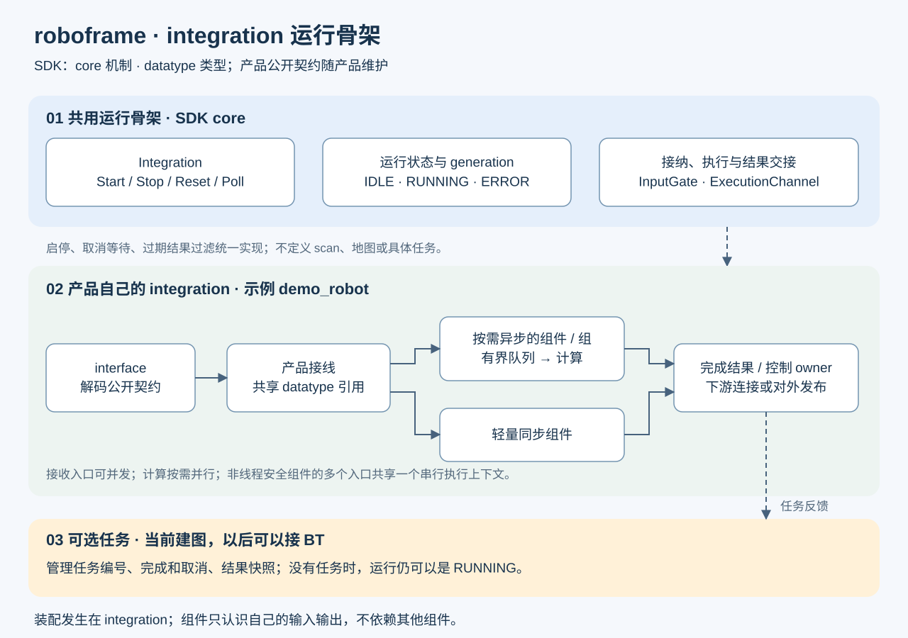

# 架构：公共运行骨架与产品接线

阅读顺序：products/demo_robot/main.cpp → sdk/include/roboframe/core/integration.hpp →
products/demo_robot/demo_robot_integration.cpp → data_flow/wiring.cpp、sensor_ingress.cpp、
result_dispatch.cpp → tasks/mapping.cpp。具体算法连接见 [建图示例](mapping.md)。

## 职责与依赖

| 层 | 拥有的职责 | 不应承担 |
|---|---|---|
| SDK core | Integration、InputGate、ExecutionChannel、基础生命周期与日志 | 产品协议、算法选择、通用消息总线 |
| SDK datatype | 实际共享的数据语义、坐标、时间、只读所有权 | 产品配置与任务状态 |
| interface | 传输、编解码、输入校验、响应和发布 | 创建具体 integration 或直接操作组件 |
| 产品 integration | 配置装配、显式接线、跨组件关联、执行预算、任务编排 | 算法内部融合与估计 |
| component | 具名输入输出、算法内部状态、局部配置与生命周期 | 其他组件、integration 或产品业务 |

组件默认完整承担一项能力，不强迫把每个算法步骤拆成组件。
Odom 是输出能力；VIOComponent、DRComponent、LIWComponent 可以独立交付，各自满足产品的位姿要求。
需要独立复用时，也可以把 DR、VIO、融合分别装配。高频融合估计仍由算法承担。
能力、类、仓库、线程不必一一对应；普通扩展组件不受预定义能力清单限制。

外部接口使用 **公开契约**：公共语义来自 SDK，产品请求来自产品 contract。
demo_robot/contract 使用 demo_robot 命名空间及 DemoRobot::contract 目标。
通用组件只链接 SDK，不自动获得产品契约头路径；定制组件可以显式依赖契约，但会成为产品相关组件。
相同语义直接使用同一类型，不为分层强制转换。准入规则详见 [SDK](../sdk/README.md)。

main 创建 integration，绑定具名输入回调和输出回调。
通用 interface/stdio_channel 只处理传输；demo_robot/interface 适配产品协议，
不包含或链接 integration 实现。另一产品沿用相同协议时可替换绑定；
新增能力或不同协议需要相应适配，并不保证 interface 永远不改。

## 运行、任务与组件生命周期

- 运行状态 IDLE / RUNNING / ERROR 描述整个运行上下文。RUNNING 不要求有任务。
- 任务状态只描述某次请求，例如建图的 mapping / finishing / ready。
- 组件 active/inactive 描述启停；active 不等于定位有效或已有地图。

Integration 实现 Start / Stop / Reset / Poll / Shutdown。产品填写配置、启动、停用、清理与结果处理钩子。
Start 创建新 generation；Stop 关闭输入、失效执行、等待协作退出，再停用组件。
Reset 先 Stop，再清产品工作状态，留在 IDLE；Shutdown 最终关闭，不允许重新 Start。
派生类析构必须在成员销毁前 Shutdown，外部输出接收者的寿命也由产品入口管理。

demo_robot 的 RUN 清工作 atlas、位姿历史、实时地图；已完成/加载的基准快照与文件保留。
BEGIN 不清数据；CANCEL 不停组件；FINISH 只冻结有限任务边界的结果。
STOP 不是无损暂停、保存或任务完成。具体保留策略属于产品，不能硬编码进 SDK。

## 统一执行骨干

~~~text
interface → typed 输入 → InputGate → 轻量调用或有界 ExecutionChannel
                                           ↓ 计算线程
                                      typed 完成结果
                                           ↓
控制 owner：Poll → Dispatch → 下游接线 / 对外发布 / 可选任务反馈
~~~

| 边界 | 执行规则 |
|---|---|
| 传感器输入 | 允许并发；InputGate 保护短接纳操作，记录接纳 generation |
| 生命周期、任务、查询、Poll | 同一个控制 owner；不允许直接并发调用 |
| ExecutionChannel handler | 选定执行组的工作线程；可包含多个组件 |
| Dispatch、产品输出回调 | 控制 owner；不得阻塞、重入或抛异常 |

输入接纳不等于计算完成。执行组容量包含排队、计算中、完成未领取结果；
慢 Poll 不能造成结果无界增长。reject_newest 拒绝新工作；latest_pending 只替换待计算工作，
适合允许跳帧的消费者，不能直接用于 IMU 积分或历史约束。

InputGate 不是算法锁或对时器。禁止在短锁内等待计算、运行重算法、回调重入同一个 gate。
产品可以为独立路径使用多个 gate；同一非线程安全算法的输入必须串行，或由算法明确保证同步。
重算法按需配置独立执行组，避免一个全局 integration 工作线程阻塞所有模块；
无需每组件一线程，也不为组件另写专属 worker。

关闭顺序是：CloseInputs → 执行组 Reset(0) → WaitIdle → 停用组件。
运行结果携带 generation，Dispatch 丢弃旧代次；任务结果还携带任务标签。
CANCEL 后旧任务计算仍可更新本次运行的实时数据，但不能修改新任务状态。
FINISH 固定已提交边界，后续输入不延长任务。计算失败不保证事务回滚；
demo_robot 进入 ERROR，恢复时清工作状态。第三方阻塞算法不能安全强杀。

## 产品数据流文件的分工

| 文件 | 内容 |
|---|---|
| sensor_ingress | 产品输入、校验、短锁内关联和轻量分发 |
| wiring | integration 装配组件和连接计算端口 |
| result_dispatch | 领取完成结果、下游分发与发布 |
| tasks/ | 可选任务的状态与结果归属 |

这些是产品内的阅读分区，不是四个必须继承的 SDK 类。
SensorIngress 的 scan/odom 配对只适用于当前产品；相机/IMU 不应照搬这一等待关卡。
跨组件时间关联由消费者需求决定；VIO 内部融合对时属于算法。
SDK 提供可复用机制和 [可编译模板](../sdk/templates/integration/README.md)，不替产品决定走线。
组件不知道 wiring 或其他组件的存在。

## 大数据与资源边界

Scan2DPtr 是 shared_ptr<const Scan2D>：解码一次，多消费者持有同一 payload。
生产者发布后也不能通过可写别名修改它；需要修改的算法建立工作区。
小 pose/transform 按值传递，按采集时刻关联，不拿最新 pose 替代。

GridSnapshot 持有不可变地图，GridCells 按块写时复制；实时更新不改变冻结或慢读者的旧快照。
子图共享 scan，只复制有限的引用/相对位姿表。外部持有引用不能由 Stop 强制回收。
这只解决进程内共享；IPC 完整地图仍需要序列化。

当前产品预算：等待 scan 64（满时丢最旧）、odom 历史 512、计算容量 8（拒绝新工作）、
每 scan 最多 2048 点、atlas 最多 4096 子图/400 万点、PoseGraph 最多 32768 节点。
队列条目、单帧大小、组件历史、外部快照和 IPC 缓存须分别评估；目前没有全进程字节预算。
文件保存/加载和完整地图编码仍同步；引入周期控制前必须隔离。

## 新增产品

新建 products/<name>，从 SDK integration 模板开始，**不复制整套 demo_robot 建图代码**：

1. Dependencies.cmake 选择 SDK 和真实组件；CMakeLists.txt 定义自己的目标和测试。
2. 定义必要的公开产品契约；公共数据已有语义则直接使用 SDK，不把产品配置追加到 SDK。
3. integration 继承 Integration，装配组件、配置启动顺序、typed 输入和结果连接。
4. 复用 InputGate、ExecutionChannel、Dispatch 和不可变数据机制；选择对时、过载、历史预算与清理策略。
5. main 绑定合适的 interface，驱动 Poll，管理回调寿命与 Shutdown。
6. 验证无任务持续运行、并发接纳、慢消费者、停止、迟到结果、资源上限及独立构建。

初期一对 integration.hpp/.cpp 即可，不强制分目录。没有建图任务就不实现 Mapping 入口。
产品构建选项为 -DROBOFRAME_PRODUCT=<name>，各自使用独立 build 目录。
当前第二产品只存在于隔离测试的临时夹具，不代表视觉产品已经实现。

未来可把 SDK、各组件、通用传输、各产品拆仓；当前目录和显式目标为此保留边界，
尚未配置子仓库，也未提供独立产品契约包的跨版本兼容保证。
