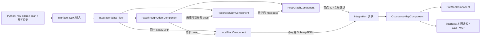

# 五组件建图链路

这是 C++14 的可运行架构验证。Odom 透传原始里程计，SLAM 回放数据集修正位姿，PoseGraph 维护坐标关系与节点；LocalMapBuilder 构建短窗口子图，MapUpdater 生成全局占据栅格。MapServer 保留保存/加载能力。
不接 Brain、不建导航空壳、不运行真实 SLAM 或图优化器。



箭头代表 integration 接线，不代表组件直接相互包含。各组件只链接 SDK，可独立构建安装；没有动态插件、万能 AddData 或组件专属 worker。

| 所有者 | 公开文件 / 当前实现 |
|---|---|
| 原始局部 pose | components/odom/include/odom/passthrough_odom_component.hpp；未来 DRComponent/VIOComponent 可以独立实现，不必塞入这个目录 |
| 修正位姿 | components/slam/include/slam/recorded_slam_component.hpp；同一 scan 与 odom 触发配对的录制参考输出 |
| 定位关系与节点 | components/posegraph/include/posegraph/pose_graph_component.hpp；当前位姿传播、T_map_odom、节点存储和显式历史修正 |
| 子图内容 | components/localmapbuilder/include/localmapbuilder/local_map_component.hpp；原始 scan 引用及局部相对 pose 的短窗口堆叠 |
| 全局栅格 | components/map-updater/include/map_updater/occupancy_map_component.hpp；消费子图与锚点，私有 occupancy_raster 负责光线更新 |
| 地图文件 | components/map-server/include/map_server/file_map_component.hpp；不位于每帧数据转发路径 |

## 数据与执行

1. Python 校验数据来源并把原始 scan、raw odom、稀疏修正位姿分别发送；数据集格式留在适配器。
2. SensorFlow 的短锁串行访问轻量 Odom、录制 SLAM、PoseGraph；PoseBuffer 按 scan 的采集时间插值 odom。真实重算法接入后按需迁到独立 ExecutionChannel。
3. SLAM 输出 MapPose2D；PoseGraph 用同一时刻的 odom 推导 T_map_odom。每次原始 odom 可传播当前全局位姿，不等待地图计算。没有修正或修正过期时输出无效。
4. 接纳的扫描注册节点，传入容量 8 的通用计算通道。LocalMapBuilder 和 MapUpdater 当前共用这个串行执行组；它们与传感器接收/轻量定位独立运行。
5. LocalMapBuilder 默认每 16 帧开始新子图。integration 在定位修正时间发生变化时也要求新锚点，避免把一次新修正混入旧子图坐标；这个策略归当前产品，不写进 SDK。
6. 子图局部原点是首帧 base。每帧保留同一 scan 引用以及 T_local_base；锚点由 PoseGraph 提供。MapUpdater 接收子图快照，正常只积分新增帧，不复制 scan payload。
7. Poll 在业务 owner 上收集计算完成结果，发布地图与任务事件。输入接纳、算法完成、对外发布是三个阶段。

## 指令与生命周期

main 装配产品并绑定 SDK ProductInputs/ProductOutputs。CONFIG 创建并激活组件；
BEGIN 开新 generation、清理定位上下文；FINISH 暂停接纳并排空，finished 事件后冻结基准地图；SAVE 保存基准地图。
本产品允许 FINISH 后继续更新实时地图，以验证旧快照稳定；这不是机器人通用工作模式。
CANCEL 关闭上下文并取消旧 generation；下一次计算重置私有子图/栅格历史，旧结果不会进入新任务。
QUIT/EOF 关闭输入、停止计算、释放历史；不会自动保存。LOAD 只加载栅格，不能恢复定位或子图更新。

## 历史修正

PoseGraph::ReviseNode 接收明确的新节点版本；MapUpdater::UpdateNode 重新放置对应子图并重建栅格，旧快照保持不变。
tests/submap_pipeline_test.cpp 直接连接五个组件，验证旧墙消失、新墙出现、旧快照不变、过期版本拒绝和取消。
当前日志没有在线历史优化事件，因此运行时回放只产生当前定位修正，不凭空修改过去节点；历史修正路径在组件组合测试中验证，尚未接外部历史约束流。
重建当前采用完整 atlas 重放；子图整体刚体变换不能修复子图内部形变。增量重建/子图重做在真实需求到来时再实现。

## 运行

```sh
cmake -S . -B build-product -DCMAKE_BUILD_TYPE=Debug
cmake --build build-product -j4
ctest --test-dir build-product --output-on-failure
python3 tools/mapping/replay.py --dataset tf --scans 0 --binary build-product/robot_runtime --output build-product/submap-result
python3 tests/build_isolation_test.py
```

输出目录必须是新目录。replay.html 可播放地图快照与轨迹，summary.json 记录节点、子图、共享点数、队列峰值和任务统计。
raw 验证原始里程计；corrected 验证 910 个配对关键帧；tf 验证全部 13,631 帧和 910 次稀疏定位修正。
完整数据最初 168 帧没有有效全局参考，明确跳过，不默认使用单位变换。
地图质量与通道吞吐是不同指标；离线回放按批次排空以避免人为过载。

## 本轮验收记录

- 本地主线整理提交：673dda7；后续链路在 codex/submap-posegraph-pipeline 分支。
- 常规回归与 UBSan 未定义行为检查各 23 项通过；包含慢计算下继续发布定位和定位过期事件、并发接收、会话切换、取消/关闭、慢读与断连。
- 六个组件各自仅依赖 SDK 构建/测试/安装；安装包重定位、无组件源码产品、混合 SOURCE/PACKAGE 及公开头文件检查通过。
- 完整 TF 回放：13,631 scan、910 次修正、1,408 子图、13,463 节点、2,353,551 个共享扫描点；队列峰值 4/8，无计算过载或历史容量拒收。
- 建图结束前 10,736 帧积分、168 帧 TF 未就绪跳过；结束后继续更新 2,727 帧，冻结快照及保存/重载一致。
- corrected 回放 910 帧无丢弃；保守连通性检查 20,039 个可达格、46.5 m 路径。此项仅为离线地图诊断，不是导航功能。
- raw 对照回放 1,000 帧通过。最终回放在 build-product/pipeline-final/replay.html，修正参考在 pipeline-corrected/。
- 验证环境为 WSL Ubuntu 22.04 / x86_64，未验证 ARM、真实 SLAM、实机时限或导航控制。
